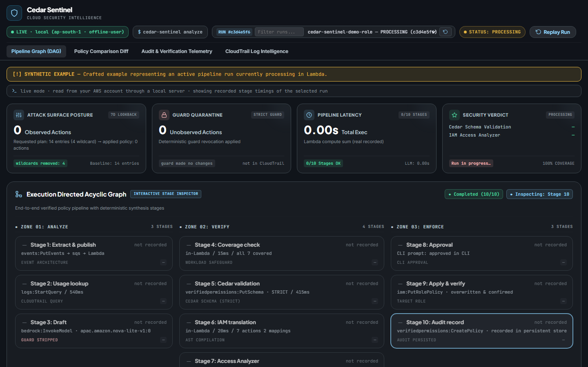
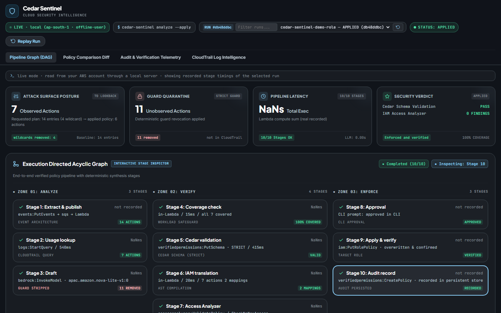
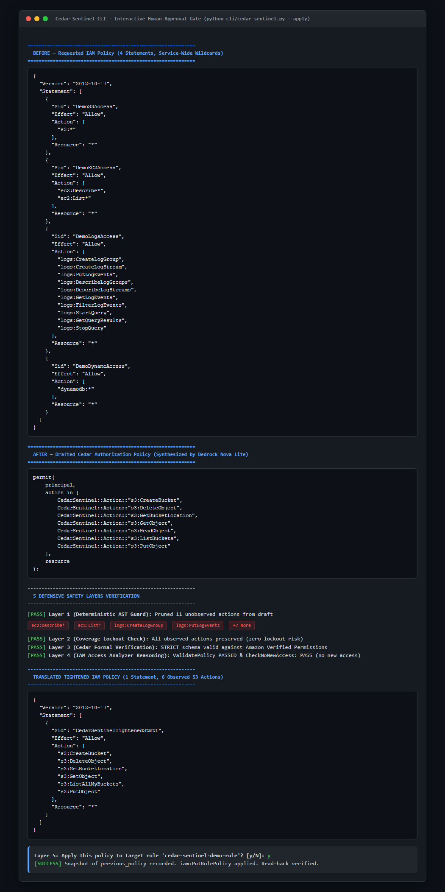
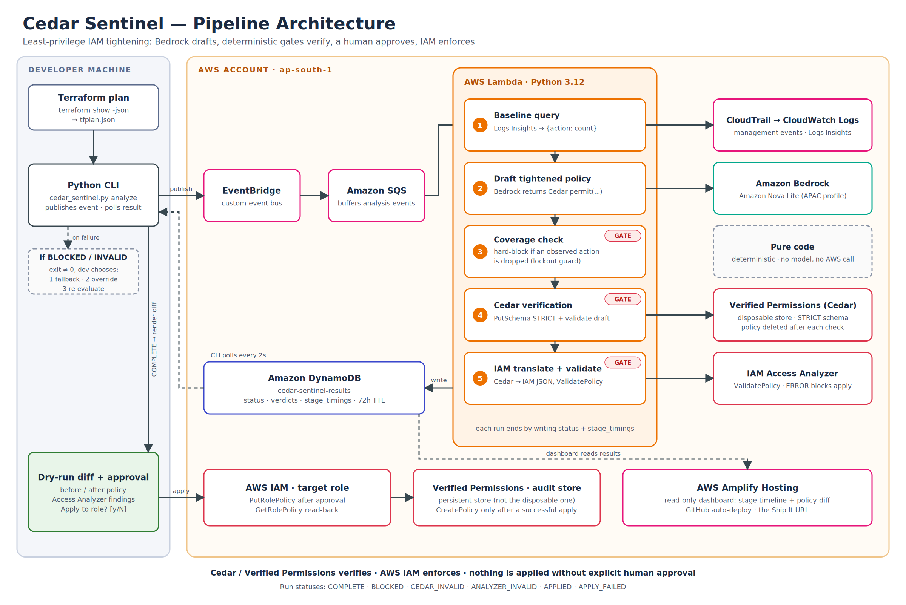
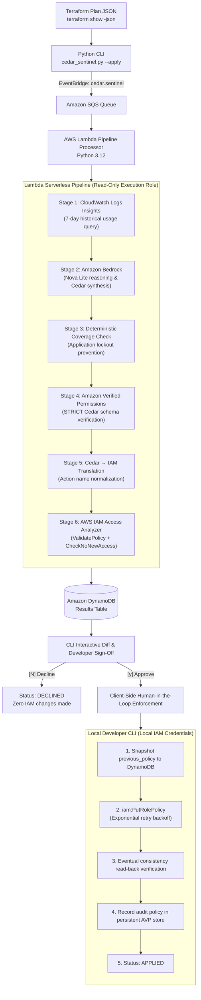

# Cedar Sentinel

> Least-privilege IAM, tightened from real usage, verified, and applied only with your approval.

[](https://community.aws)
[-blue)](#)
[](#)
[](LICENSE)
[](https://github.com/Akaash-S/cedar-sentinel/actions/workflows/ci.yml)
[](https://main.d3i4xcsmv7sca9.amplifyapp.com)

---

## Quick Links

- 🌐 **Live Dashboard (Amplify):** https://main.d3i4xcsmv7sca9.amplifyapp.com
- 📺 **Demo Video:** [Watch Demonstration (YouTube)](https://www.youtube.com/watch?v=RWHE0VpiZ4A)
- 📝 **AWS Builder Center Post:** [Building Cedar Sentinel — Read Article](https://builder.aws.com/content/3JbM8Pcnay8y9zrzhBRWiCaCwgC/building-cedar-sentinel-an-ai-least-privilege-iam-tightener-that-never-applies-anything-without-your-approval)
- 📐 **Architecture Documentation:** [docs/architecture.md](docs/architecture.md)
- 🤖 **AI Tool Disclosure:** [docs/ai-tool-disclosure.md](docs/ai-tool-disclosure.md)
- 📜 **Attribution Log:** [docs/attribution.md](docs/attribution.md)

---

## 1. Problem Statement

Cloud infrastructure teams routinely deploy broad IAM permissions (such as `s3:*` or wildcard actions) during development to avoid blocking velocity, planning to tighten them before production. In practice, manual policy auditing is tedious, error-prone, and disconnected from deployment pipelines. Static linters flag wildcards but cannot know which permissions workloads actually need at runtime, while over-tightening risks silent application lockouts and breaking production deployments.

---

## 2. What Cedar Sentinel Does

Cedar Sentinel bridges the gap between infrastructure-as-code and runtime activity through a 10-stage automated pipeline:

1. **Extracts Planned IAM Policies:** Reads IAM role policy definitions directly from Terraform plan JSON output (`terraform show -json`).
2. **Queries Historical Telemetry:** Queries CloudWatch Logs Insights across a 7-day lookback window to discover exact API actions invoked by the workload.
3. **Applies Deterministic Lockout Guard:** Extracts observed actions and verifies that necessary workload operations are never dropped.
4. **Synthesizes Cedar Policy:** Uses Amazon Bedrock (Nova Lite) to draft a minimal, human-readable Cedar authorization policy.
5. **Enforces Formal Cedar Verification:** Validates the draft policy in `STRICT` mode against a schema in Amazon Verified Permissions (AVP).
6. **Translates to Minimal IAM JSON:** Converts verified Cedar `permit` statements into standard AWS IAM JSON policy syntax.
7. **Normalizes Action Names:** Deterministically maps CloudTrail event names to valid IAM action identifiers (e.g., `s3:ListBuckets` $\rightarrow$ `s3:ListAllMyBuckets`).
8. **Validates via IAM Access Analyzer:** Executes `ValidatePolicy` (syntax correctness) and `CheckNoNewAccess` (proves the tightened policy grants no new access relative to the baseline policy).
9. **Interactive Human Approval:** Displays an interactive git-style before/after diff in the CLI for explicit developer sign-off (`[y/N]`).
10. **Safe Enforcement & Audit:** Snapshots the prior policy to DynamoDB, applies the tightened policy via `iam:PutRolePolicy`, verifies read-back consistency, and logs the approved policy to a persistent AVP audit store.

---

## 3. Key Empirical Results & Verified Metrics

Every metric below is directly verifiable from repository artifacts and live AWS experiment execution outputs:

### 1. Test Role Policy Reduction (Before vs. After)
* **Baseline Policy (Terraform Plan Request):** **4 statements** with broad, service-wide wildcards (`s3:*`, `ec2:Describe* / ec2:List*`, `logs:*` [10 management actions], and `dynamodb:*`) on `Resource: "*"`.
* **Tightened IAM Policy (Generated & Verified):** Reduced to **1 statement** of **6 observed S3 actions** (`s3:CreateBucket`, `s3:DeleteObject`, `s3:GetBucketLocation`, `s3:GetObject`, `s3:ListAllMyBuckets`, `s3:PutObject`).
* **Automated Safety Invariants:** 11 unobserved EC2 and CloudWatch Logs actions automatically pruned by the AST Guard; AWS IAM Access Analyzer `CheckNoNewAccess` returned `PASS` (proves zero privilege escalation relative to baseline).
* **Source Verification File:** [`dashboard/runs/applied.json`](dashboard/runs/applied.json#L51-L120)

### 2. Multi-Workload Benchmark (50 Live Runs Across 5 Plans)
Tested over **50 live runs** (5 distinct IAM workloads $\times$ 10 iterations) against Amazon Bedrock Nova Lite, Amazon Verified Permissions, and AWS IAM Access Analyzer in `ap-south-1`:

| Plan ID | Workload Profile | Baseline Stmts / Actions / Wildcards | Tightened Stmts / Actions / Wildcards | Status / Outcome | Verified Source File |
|---|---|---|---|---|---|
| `plan_1_s3_ingest` | S3 Ingestion Pipeline | 1 stmt / 1 action (`s3:*`) / 1 WC | 1 stmt / 3 actions / 0 WC | 10/10 Approved (`CheckNoNewAccess: PASS`) | [`experiments/experiment_results.json`](experiments/experiment_results.json) |
| `plan_2_microservice` | DynamoDB + SQS Order Service | 2 stmts / 2 actions / 2 WC | 2 stmts / 4 actions / 0 WC | 10/10 Approved (`CheckNoNewAccess: PASS`)* | [`experiments/experiment_results.json`](experiments/experiment_results.json) |
| `plan_3_monitoring` | CloudWatch Logs Daemon | 2 stmts / 3 actions / 2 WC | 2 stmts / 3 actions / 0 WC | 10/10 Approved (`CheckNoNewAccess: PASS`) | [`experiments/experiment_results.json`](experiments/experiment_results.json) |
| `plan_4_analytics_overpermissive` | Over-Permissive Analytics Role | 4 stmts / 6 actions / 4 WC | 1 stmt / 2 actions / 0 WC | 10/10 Approved (`CheckNoNewAccess: PASS`) | [`experiments/experiment_results.json`](experiments/experiment_results.json) |
| `plan_5_edge_case_lockout` | Unrequested Write (Lockout Edge) | 1 stmt / 1 action / 0 WC | 1 stmt / 1 action / 0 WC | **9/10 BLOCKED** (1/10 approved) | [`experiments/experiment_results.json`](experiments/experiment_results.json) |

*\*Note on Plan 2:* Evaluated with dummy account `123456789012` after fixing the initial test fixture's un-substituted literal `<ACCOUNT_ID>` placeholder string, which Access Analyzer correctly caught and rejected with `INVALID_ARN_ACCOUNT`.

### 3. Defensive Safety Layer Rejections (50 Runs)
* **Layer 1 (Deterministic AST Guard):** **2 interventions** (pruned unobserved actions synthesized by the model).
* **Layer 2 (Coverage Lockout Check):** **9 blocks** (blocked Plan 5 across 9/10 runs when the unrequested observed write action was omitted, preventing production lockout).
* **Layer 3 (Cedar Formal Verification in AVP):** **0 rejections** (all generated Cedar policies conformed to STRICT schema).
* **Layer 4 (IAM Access Analyzer Reasoning):** **0 rejections** with valid dummy account ARNs (proves zero new access).
* **Layer 5 (Interactive Human Approval):** **0 rejections** (human-in-the-loop sign-off gate).
* **Source Verification File:** [`experiments/experiment_results.json:summary.safety_layer_rejections`](experiments/experiment_results.json)

### 4. Operational Latency, Tokens, and Cost
* **Median End-to-End Latency:** **11.97 s** (P95: **29.87 s**) across full pipeline execution.
* **CloudWatch Telemetry Optimization:** Adaptive polling reduced median log query latency from **3.79 s** to **0.77 s** (**4.9× speedup**; CloudWatch stage accounts for 28.72% of total pipeline latency).
* **Bedrock Nova Lite Token Usage:** Average **264.6 input tokens** and **362.1 output tokens** per analysis.
* **Bedrock Operational Cost:** **$0.000103 USD per run** (~**$0.1028 per 1,000 policy analyses**; total 50-run suite cost was **$0.0051 USD**).
* **Source Verification File:** [`experiments/experiment_results.json:summary`](experiments/experiment_results.json)

### 5. Automated Verification Suite
* **38 automated unit tests** (26 CLI + 12 Lambda; 34 offline tests requiring zero AWS credentials + 4 live AWS Access Analyzer tests).
* **10 sanitized recorded run fixtures** validating all terminal and transient pipeline states.
* **Source Verification Files:** [`cli/test_enforcement.py`](cli/test_enforcement.py), [`cli/test_dashboard_server.py`](cli/test_dashboard_server.py), [`lambda/test_translator.py`](lambda/test_translator.py), [`lambda/test_access_analyzer.py`](lambda/test_access_analyzer.py)

---

### Pipeline Visualizations & CLI Review

| Dual-Mode Telemetry Dashboard | Run Detail & Automated Reasoning Diff |
|---|---|
|  |  |

| CLI Interactive Human Approval Gate (`cedar_sentinel.py --apply`) |
|---|
|  |

---

## 4. Pipeline Architecture



> **Core Distinction:** Cedar and Amazon Verified Permissions **verify** policy syntax and schema correctness; AWS IAM **enforces** live permissions at runtime.



### Understanding Stages vs. Defensive Layers
The system is architected around a clear separation between execution **stages** (the sequential processing pipeline) and defensive **layers** (the security invariants and verification gates enforced within those steps):
* **The 10-Stage Pipeline:** Represents the complete end-to-end user and infrastructure lifecycle—from developer CLI plan extraction (Stages 1–2), through asynchronous EventBridge/SQS ingestion and Lambda execution (Stages 3–8), to interactive human approval and client-side IAM application (Stages 9–10).
* **Lambda Stages 1–6:** Represent the automated serverless processing engine (`lambda/handler.py`). Lambda sequentially executes: (1) CloudWatch Logs historical query, (2) Amazon Bedrock policy reasoning, (3) Coverage/lockout check, (4) Amazon Verified Permissions Cedar validation, (5) Cedar-to-IAM translation, and (6) IAM Access Analyzer automated reasoning.
* **The 5 Defensive Safety Layers:** Represent the validation gates embedded inside those stages:
  1. *Layer 1 (AST Guard)* inside Lambda Stage 2 automatically strips unobserved model hallucinations.
  2. *Layer 2 (Coverage Check)* inside Lambda Stage 3 halts execution if observed actions were dropped.
  3. *Layer 3 (Cedar Formal Verification)* inside Lambda Stage 4 checks Cedar syntax against AVP in `STRICT` mode.
  4. *Layer 4 (Access Analyzer Automated Reasoning)* inside Lambda Stage 6 proves no privilege escalation relative to baseline.
  5. *Layer 5 (Human Approval Gate)* inside CLI Stage 9 displays the interactive diff and halts for explicit developer confirmation before applying live changes.

---

## 5. AWS Services Used & Why

| AWS Service | Role in Cedar Sentinel | Why This Service |
|---|---|---|
| **Amazon Bedrock (Nova Lite)** | Policy Reasoning & Synthesis | Fast, cost-efficient LLM reasoning to translate observed API history into minimal Cedar statements without marketplace friction. |
| **Amazon Verified Permissions (AVP)** | Cedar Formal Verification & Audit | Validates draft Cedar policies in `STRICT` schema mode and maintains an immutable audit store of approved policies. |
| **AWS Lambda** | Serverless Processing Engine | Event-driven 10-stage execution pipeline orchestration with zero persistent server overhead. |
| **Amazon EventBridge & SQS** | Decoupled Event Ingestion | Reliable asynchronous event routing and durable buffering between developer CLI triggers and Lambda workers. |
| **CloudTrail + CloudWatch Logs Insights** | Historical Workload Telemetry | Captures real API invocations and provides sub-second indexed queries across the lookback window. |
| **AWS IAM Access Analyzer** | Automated Reasoning Safety Net | Automated reasoning check of syntax correctness (`ValidatePolicy`) and proves the tightened policy grants no new access relative to the baseline policy (`CheckNoNewAccess`). |
| **AWS IAM** | Live Permission Enforcement | Enforces scoped inline policies on target IAM roles with snapshotting and read-back verification. |
| **Amazon DynamoDB** | Pipeline Results & State Store | Fast key-value persistence for run telemetry, diffs, previous policy snapshots, and dashboard feeds. |
| **AWS Amplify** | Static Dashboard Hosting | Continuous deployment and global delivery for the static DevOps telemetry dashboard. |

---

## 6. Safety Model & The 5 Defensive Layers

Cedar Sentinel enforces security through 5 progressive, defense-in-depth safety layers before any IAM policy can ever be applied:

1. **Layer 1: Deterministic AST & Prompt Guard** ([`lambda/handler.py:stage_2_bedrock_reasoning`](lambda/handler.py)): Inspects model output against requested baseline and observed telemetry, automatically stripping hallucinated or unobserved actions.
2. **Layer 2: Deterministic Coverage & Lockout Guard** ([`lambda/handler.py:stage_coverage_check`](lambda/handler.py)): Asserts that every single action observed in CloudTrail telemetry remains permitted in the generated policy. If an observed action was dropped, the pipeline enters `BLOCKED` status and halts immediately, preventing production application lockouts.
3. **Layer 3: Cedar Formal Schema Verification in AVP** ([`lambda/handler.py:stage_cedar_validation`](lambda/handler.py)): Validates Cedar syntax and STRICT schema compatibility against Amazon Verified Permissions. *(AVP serves as a policy verification and audit layer, not a runtime authorization gate; live AWS permissions are enforced exclusively by IAM).*
4. **Layer 4: IAM Access Analyzer Automated Reasoning** ([`lambda/handler.py:stage_access_analyzer`](lambda/handler.py)): Runs AWS IAM Access Analyzer `ValidatePolicy` (validating IAM syntax and ARN compliance) and `CheckNoNewAccess` (proves the tightened policy grants no new access relative to the baseline policy).
5. **Layer 5: Interactive Human Approval Gate** ([`cli/cedar_sentinel.py:execute_enforcement_flow`](cli/cedar_sentinel.py)): Displays an interactive colorized before/after diff in the developer CLI and halts for explicit `[y/N]` confirmation.

### Core Architectural Guarantees
- **Zero IAM Write Permissions in Lambda:** The Lambda execution role has zero `iam:Put*`, `iam:Create*`, `iam:Attach*`, or `iam:Delete*` permissions; the Lambda role has no IAM write permissions to modify live IAM roles.
- **Client-Side Enforcement:** Applying changes (`iam:PutRolePolicy`) is executed strictly client-side by the developer CLI using local AWS credentials, and only after interactive human sign-off.
- **Rollback Snapshotting:** Automatically records `previous_policy` in DynamoDB prior to updating live IAM roles.
- **Self-Analysis Protection:** The CLI strictly refuses to modify Cedar Sentinel's own execution role unless explicit override flags are supplied.

---

## 7. How Cedar Sentinel Relates to IAM Access Analyzer

AWS IAM Access Analyzer already generates policies from CloudTrail activity and recommends removing unused permissions.

**Cedar Sentinel builds on Access Analyzer — it does not replace it.** It incorporates Access Analyzer's `ValidatePolicy` and `CheckNoNewAccess` APIs directly inside its pipeline. What Cedar Sentinel adds is an automated deploy-time workflow:
1. Intercepts policies from Terraform plans before they are applied.
2. Drafts human-readable Cedar policies and verifies them against Amazon Verified Permissions.
3. Automatically maps CloudTrail event names to valid IAM action names.
4. Provides an interactive developer approval step with automated rollback snapshots.

---

## 8. Prerequisites

- **AWS Account:** With active credentials in your chosen region (e.g., `ap-south-1` or `us-east-1`).
- **CloudTrail Trail:** Delivering management events to CloudWatch Logs.
- **Amazon Bedrock Access:** `amazon.nova-lite-v1:0` access enabled in your region.
- **Local Tooling:**
  - Python 3.12+
  - AWS CLI v2 (`aws configure`)
  - AWS SAM CLI (for deployment)
  - Terraform (for generating plan files)

---

## 9. Deployment

1. Configure environment parameters:
   ```bash
   cp infra/samconfig.toml.example infra/samconfig.toml
   cp infra/.env.example infra/.env
   ```
2. Build and deploy the SAM stack:
   ```bash
   cd infra
   sam build
   sam deploy --guided
   ```

---

## 10. Running Cedar Sentinel

### The Two-Command Developer Workflow

1. **Generate Terraform Plan JSON:**
   ```bash
   terraform plan -out=tfplan.binary
   terraform show -json tfplan.binary > tfplan.json
   ```
   *(On Windows PowerShell, use `terraform show -json tfplan.binary | Out-File -Encoding ascii tfplan.json` to avoid UTF-16 BOM encoding issues).*

2. **Run Policy Analysis & Enforcement:**
   ```bash
   python cli/cedar_sentinel.py analyze \
     --plan-file tfplan.json \
     --role-arn arn:aws:iam::<ACCOUNT_ID>:role/cedar-sentinel-demo-role \
     --policy-name demo-broad-s3 \
     --apply
   ```

---

## 11. Reproduce the Demo

1. **Reset Role to Broad Baseline:**
   ```bash
   python scripts/reset_demo_role.py --role-name cedar-sentinel-demo-role --policy-name demo-broad-s3
   ```
2. **Execute Analysis & Apply:**
   ```bash
   python cli/cedar_sentinel.py analyze \
     --plan-file cli/fixtures/demo-role-plan.json \
     --role-arn arn:aws:iam::<ACCOUNT_ID>:role/cedar-sentinel-demo-role \
     --policy-name demo-broad-s3 \
     --apply
   ```
3. Type `y` when prompted. The tightened policy is applied, verified, and audited.

---

## 12. Local Dashboard (Live Mode)

Start a local, read-only developer dashboard server running exclusively on `127.0.0.1`:

```bash
# Start live dashboard (queries DynamoDB using local AWS credentials)
python cli/cedar_sentinel.py dashboard

# Start dashboard focused on a specific run
python cli/cedar_sentinel.py dashboard --run-id <REQUEST_ID>

# Run offline against recorded fixtures (zero AWS calls)
python cli/cedar_sentinel.py dashboard --offline-dir dashboard/runs
```

---

## 13. IAM Permissions Required

### Developer User Minimal Policy
```json
{
  "Version": "2012-10-17",
  "Statement": [
    {
      "Sid": "EventBridgeSubmit",
      "Effect": "Allow",
      "Action": "events:PutEvents",
      "Resource": "arn:aws:events:<REGION>:<ACCOUNT_ID>:event-bus/cedar-sentinel-events"
    },
    {
      "Sid": "DynamoDBResultsPolling",
      "Effect": "Allow",
      "Action": ["dynamodb:GetItem", "dynamodb:Scan"],
      "Resource": "arn:aws:dynamodb:<REGION>:<ACCOUNT_ID>:table/cedar-sentinel-results"
    },
    {
      "Sid": "IamManagement",
      "Effect": "Allow",
      "Action": ["iam:GetRolePolicy", "iam:PutRolePolicy", "iam:ListRolePolicies"],
      "Resource": "arn:aws:iam::<ACCOUNT_ID>:role/cedar-sentinel-*"
    }
  ]
}
```

---

## 14. Test Suite & Verification

Run the automated test suite (38 unit tests):

```bash
# Run 34 offline unit tests (zero AWS credentials required)
pytest -m "not live" -v

# Run full suite including live AWS tests (when AWS credentials are configured)
pytest -v

# CLI Unit Tests (26 tests)
python -m unittest discover cli/ -v

# Lambda Handler & Translator Tests (12 tests)
python -m unittest discover lambda/ -v

# Run Fixtures & Sanitization Validation (10 runs)
python scripts/validate_runs.py

# 50-Run Empirical Experiment Suite across 5 IAM Plans
python experiments/run_experiments.py
```

### Verified Test Suite & Latency / Cost Metrics
- **Automated Unit Tests:** **38 unit tests** (26 CLI + 12 Lambda), 100% passing. (34 pure offline unit tests + 4 live IAM Access Analyzer tests marked `@pytest.mark.live`).
- **In-Lambda Processing Latency (Happy Path):** **5.52 s – 5.55 s** total internal execution time (measured in live Lambda runs recorded in `dashboard/runs/complete.json` [5.52 s] and `dashboard/runs/applied.json` [5.55 s]).
- **Laptop-Driven Experiment Latency (50 Live AWS Runs across 5 Plans):** **Median 11.97 s (~12.0 s)**, **P95 29.87 s (~29.9 s)** over network via `boto3`.
- **Bedrock Nova Lite Token & Cost per Run:** **~$0.0001 USD** ($0.000103 USD per policy analysis; ~$0.1028 per 1,000 policy generations with avg 264.6 input and 362.1 output tokens).
- See [experiments/README.md](experiments/README.md) for the complete empirical analysis and raw 50-run dataset.

---

## 15. Limitations & Mitigations

1. **Experimental & Evaluation Scope:** Tested on a small number of real CloudTrail events and 50 live experiment runs across 5 distinct IAM plans; no high-concurrency load testing has been conducted.
2. **Amplify Dashboard is Static Replay:** The publicly deployed AWS Amplify dashboard ([main.d3i4xcsmv7sca9.amplifyapp.com](https://main.d3i4xcsmv7sca9.amplifyapp.com)) is a static replay of 10 sanitized runs from `dashboard/runs/`. Real-time interactive analysis runs via the local developer CLI and dashboard server (`python cli/cedar_sentinel.py dashboard`).
3. **Cedar / AVP is an Audit & Verification Layer:** Amazon Verified Permissions validates Cedar syntax and schema compatibility in `STRICT` mode and serves as an immutable policy audit store. It is **not a runtime authorization gate** (runtime authorization in AWS is enforced solely by AWS IAM).
4. **Lambda Execution Role Zero IAM Write Permissions:** The Lambda processor has zero `iam:Put*`, `iam:Create*`, `iam:Attach*`, or `iam:Delete*` permissions. Applying policy modifications strictly requires developer CLI invocation with human `[y/N]` approval.
5. **Plan 2 Access Analyzer Verification & Account ID Formatting:** In initial experiment runs, Plan 2 (DynamoDB & SQS) was rejected by Access Analyzer in 10/10 runs with finding code `INVALID_ARN_ACCOUNT` because the fixture contained the literal placeholder `<ACCOUNT_ID>` in resource ARNs, which Access Analyzer strictly rejected as malformed ARN syntax. When updated with the valid 12-digit dummy account `123456789012`, Plan 2 passed Access Analyzer `ValidatePolicy` and `CheckNoNewAccess` across all 10/10 runs cleanly (0 new access, 2 statements, 4 actions). This verified both that Layer 4 acts as an independent syntax and ARN safety net, and that valid microservice policies pass automated reasoning verification.
6. **Resource Wildcards:** The pipeline tightens IAM `Action` sets down to observed API calls, but preserves requested resource ARNs (e.g. `Resource: "*"` or specific bucket ARNs). Dynamic ARN synthesis from CloudTrail `requestParameters` is future work.
7. **Action Normalization Coverage:** Covers major S3, DynamoDB, SQS, and CloudWatch Logs CloudTrail-to-IAM API disparities. Arbitrary unmapped actions are handled defensively without widening to `*`.
- See [docs/limitations-and-mitigations.md](docs/limitations-and-mitigations.md) for full architectural documentation.

---

## 16. Roadmap

- [ ] **Automated Terraform HCL Patching:** Directly update `.tf` source files after approval to prevent Terraform drift.
- [ ] **CI/CD GitHub Action:** PR-comment integration for pull request workflows.
- [ ] **Multi-Account Support:** AWS Organizations telemetry ingestion via centralized CloudTrail.
- [ ] **Automated CLI Rollback Command:** One-click rollback from DynamoDB snapshots.

---

## 17. Project Structure

```
cedar-sentinel/
├── .github/
│   └── workflows/
│       └── ci.yml             # GitHub Actions CI workflow (offline test suite)
├── cli/                       # Developer CLI, local dashboard server, test plans
│   ├── fixtures/              # Test Terraform plan fixtures for analysis
│   │   ├── demo-role-plan.json
│   │   ├── full-scope-plan.json
│   │   ├── sample_tfplan.json
│   │   └── video-role-plan.json
│   ├── cedar_sentinel.py      # Main developer CLI entrypoint
│   ├── dashboard_server.py    # Local read-only HTTP server (127.0.0.1)
│   ├── requirements.txt       # CLI client dependencies
│   ├── run_data.py            # Fixture loading and account ID sanitization
│   ├── test_dashboard_server.py # Unit tests for dashboard server endpoints & headers
│   └── test_enforcement.py    # Unit tests for CLI enforcement & approval flow
├── dashboard/                 # Dual-mode web dashboard & sanitized operational state
│   ├── runs/                  # 10 sanitized recorded run fixtures for static replay
│   └── index.html             # Vanilla CSS/JS dashboard interface
├── docs/                      # Architectural specs, differentiators, and disclosures
│   ├── archive/               # Historical phase implementation documents
│   ├── ai-tool-disclosure.md  # Dated log of AI assistance and tool disclosures
│   ├── architecture.md        # Detailed pipeline architecture & sequence diagrams
│   ├── attribution.md         # Design, font, and asset attributions
│   ├── aws-console-setup.md   # Manual AWS console provisioning walkthrough
│   ├── cedar_sentinel_architecture.png
│   ├── cedar_sentinel_pipeline_stepper.png
│   ├── differentiators.md     # Competitive analysis and architectural trade-offs
│   ├── limitations-and-mitigations.md # Audited limitations and mitigation register
│   └── screenshots/           # High-resolution dashboard and CLI diff screenshots
├── experiments/               # Empirical benchmark suite & live AWS results
│   ├── experiment_results.json # Sanitized 50-run live evaluation data
│   ├── README.md              # Experiment methodology, latency, and cost analysis
│   └── run_experiments.py     # 50-run automated benchmark runner (5 plans × 10 runs)
├── infra/                     # AWS SAM template & deployment configuration
│   ├── .env.example
│   ├── samconfig.toml.example
│   └── template.yaml          # EventBridge, SQS, Lambda, DynamoDB SAM template
├── lambda/                    # Serverless reasoning & evaluation pipeline
│   ├── handler.py             # Lambda event processor (Stages 1–6)
│   ├── requirements.txt       # Lambda runtime dependencies
│   ├── test_access_analyzer.py # Access Analyzer integration unit tests
│   ├── test_cedar_rejection.py # Cedar schema rejection unit tests
│   ├── test_option2_stub.py   # Lockout override disablement verification
│   └── test_translator.py     # Cedar-to-IAM translation and AST guard unit tests
├── scripts/                   # Administrative, auditing, and export utilities
│   ├── reset_demo_role.py     # Re-initializes baseline IAM demo role state
│   ├── capture_screenshots.py # Headless Playwright script to capture dashboard PNGs
│   ├── export_run.py          # Script to export live DynamoDB runs to sanitized JSON
│   ├── scan_secrets.py        # Automated secrets and account ID detector
│   └── validate_runs.py       # Structural schema validator for recorded runs
├── .gitignore
├── conftest.py                # Pytest configuration and custom markers
├── LICENSE                    # MIT License
├── pytest.ini                 # Pytest runner settings
└── README.md                  # System overview, architecture, and documentation
```

---

## 18. AI Tools & Attribution

- **AI Tools Used:** See [docs/ai-tool-disclosure.md](docs/ai-tool-disclosure.md) for complete dated log (Claude, Antigravity, Google Stitch, Amazon Nova Lite on Bedrock).
- **Attributions:** See [docs/attribution.md](docs/attribution.md) for fonts, icons, and design licenses.

---

## 19. License

This project is licensed under the MIT License - see the [LICENSE](LICENSE) file for details.
